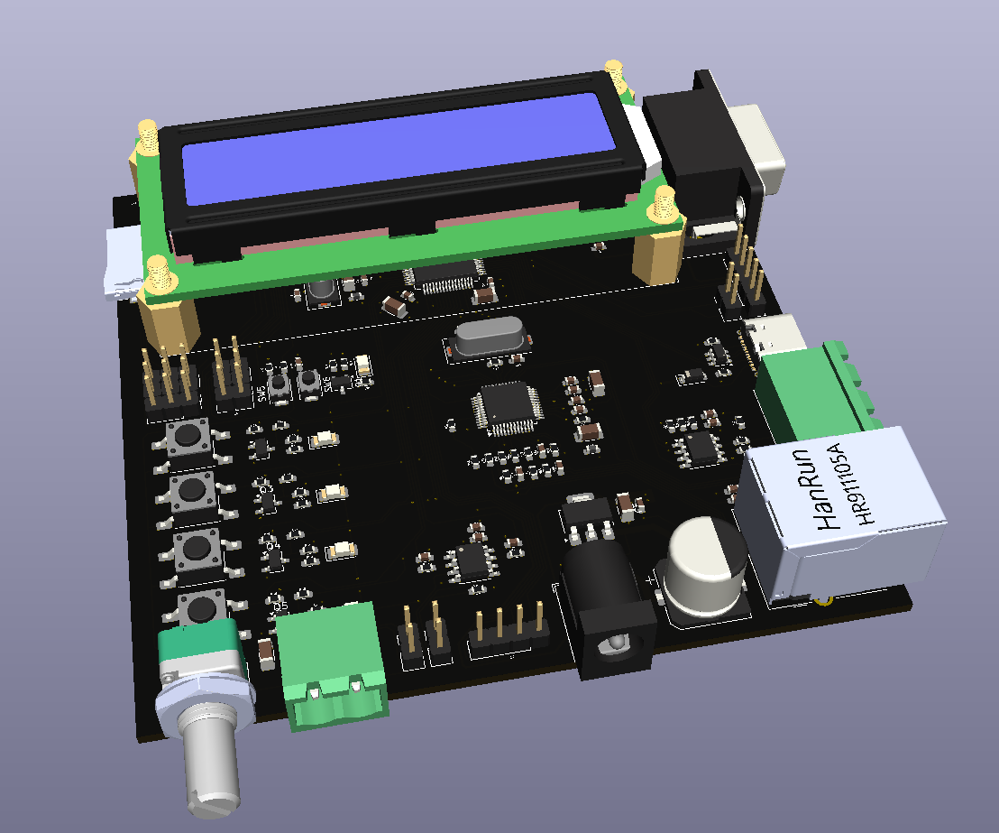
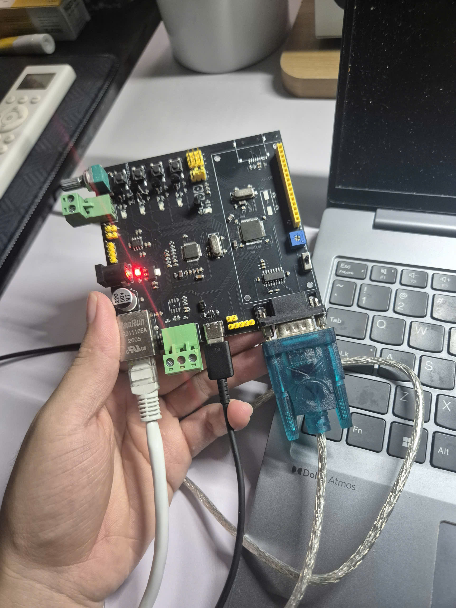

# STM32F401 Development Board

Bo mạch phát triển tùy chỉnh sử dụng vi điều khiển STM32F401, được thiết kế bằng phần mềm KiCad.

---

## 1. Tổng quan PCB

### Mô hình PCB 3D


### Ảnh bo mạch thực tế


---

## 2. Mô tả dự án

Dự án tập trung vào thiết kế sơ đồ nguyên lý (schematic) và thiết kế mạch in (PCB) cho một bo mạch phát triển dựa trên vi điều khiển STM32F401.

Bo mạch được phát triển nhằm phục vụ cho việc nghiên cứu hệ thống nhúng, phát triển firmware, giao tiếp ngoại vi, thử nghiệm phần cứng và xây dựng các ứng dụng điều khiển sử dụng vi điều khiển.

---

## 3. Tính năng chính

- Thiết kế schematic và PCB hoàn toàn tùy chỉnh.
- Sử dụng vi điều khiển dòng STM32F401.
- Thiết kế và đi dây PCB bằng KiCad.
- Kiểm tra mô hình 3D để đánh giá bố trí linh kiện và khả năng lắp ráp cơ khí.

---

## 4. Thông số phần cứng

| Thông số | Giá trị |
| :--- | :--- |
| **Vi điều khiển** | STM32F401 Series |
| **Phần mềm thiết kế** | KiCad (Schematic Editor, PCB Editor, 3D Viewer) |
| **Nguồn cấp** | 5V DC |
| **Kích thước PCB** | 100 mm × 100 mm |
| **Số lớp PCB** | 2 lớp |
| **Giao tiếp ngoại vi** | 1× RS232 (MAX3232), 1× RS485 (MAX3485), 1× Ethernet (W5500) |
| **I/O & Ngoại vi khác** | 2× ADC, 4× Button, 5× LED |

---

## 5. Quy trình thiết kế

1. Thiết kế sơ đồ nguyên lý (Schematic).
2. Lựa chọn linh kiện và gán footprint.
3. Bố trí linh kiện và đi dây PCB.
4. Kiểm tra quy tắc thiết kế (DRC).

---

## 6. Công cụ sử dụng

- **KiCad**: Thiết kế nguyên lý, PCB, quản lý footprint và kiểm tra mô hình 3D.
- **Git**: Quản lý phiên bản mã nguồn cục bộ.
- **GitHub**: Lưu trữ mã nguồn và tài liệu dự án trực tuyến.

---

## 7. Cấu trúc Repository

```text
├── *.kicad_pro    # Tệp cấu hình dự án KiCad
├── *.kicad_sch    # Thiết kế sơ đồ nguyên lý
├── *.kicad_pcb    # Thiết kế mạch in PCB
└── images/        # Hình ảnh thực tế và ảnh render 3D